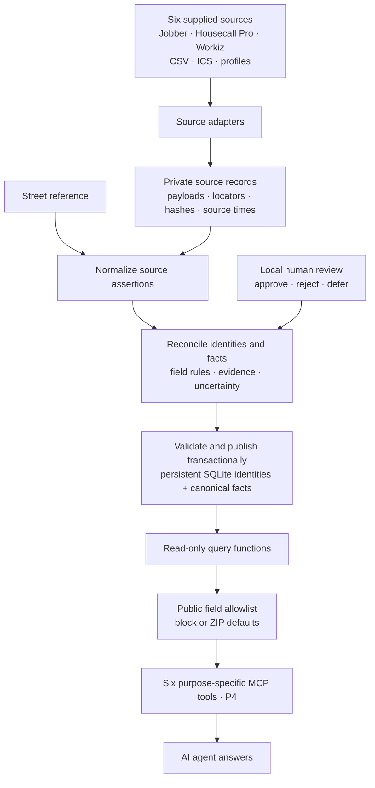
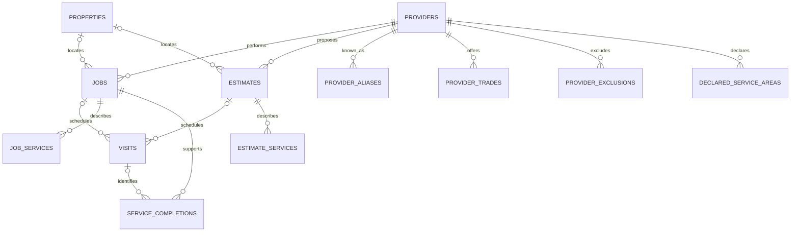
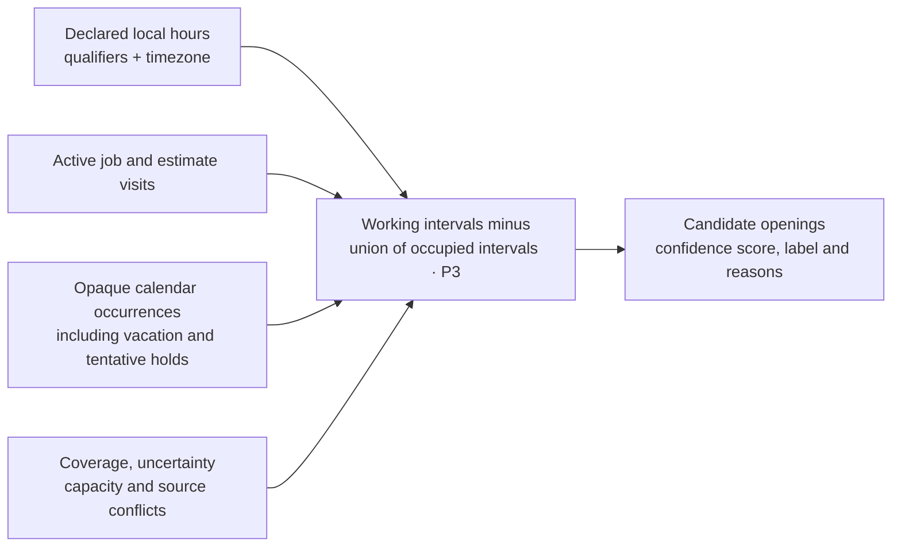

# Home services data layer and MCP

**Status — October 24, 2026:** P1 ingestion, P2 reconciliation/history/review and the P2R relational redesign are implemented locally. Schema version 2 uses entity-specific source tables, relational canonical facts and a persistent SQLite database. The diagrams describe the local implementation except pieces explicitly marked P3/P4. Availability, MCP serving and continuous production sync remain future work.

## Data flow

Adapters interpret source formats; normalized assertions retain source-specific evidence. Reconciliation selects canonical facts without rewriting originals. Deterministic matches can apply automatically; ambiguous identities and inferred corrections require local review. Source records, field lineage and decision references explain answers internally. The agent receives safe facts and opaque evidence references, not raw records or arbitrary SQL access.

## Core schema

Important relationships are shown below; supporting evidence and vocabulary tables are summarized afterward. Diagram labels abbreviate the physical canonical table names. The visit's parent is **exactly one** job or estimate; provider/property come through that parent.

| Table family | Stored facts and rules |
| --- | --- |
| Providers / properties | Persistent IDs; business label; normalized address including unit state; qualified geocode. Missing property links remain explicit, not fabricated homes. |
| Jobs / estimates | Provider, optional resolved property, lifecycle/state; job amount in exact minor units. An estimate is not performed work. |
| Visits | One parent, scheduling state, scheduled endpoints with value/state/precision and timezone. Source worker assignments are evidence, not established independent crew capacity. |
| Services / completions | Multiple classified services and safe descriptions per job/estimate. Completion evidence links to a job and optionally a visit; specific service credit requires evidence. |
| Provider relationships | Aliases, trades, exclusions and declared ZIPs are related rows. Observed coverage is derived separately from service history. |
| Source / lineage / review | Original records and occurrences, entity-specific normalized tables, source-to-canonical links, field derivations and private review evidence. |
| Identity registry | Stable canonical IDs and membership, merge redirects and ambiguous split references. Retained across imports. |

Searchable facts and relationships use SQL columns, checks and foreign keys. Raw payloads and variable evidence may remain JSON. Dictionaries constrain service/trade codes; safe descriptions use approved wording rather than exposed source text. The [column contract](docs/schema-columns-draft.md) contains value lists; executable constraints live in `src/house_account/schema.py` and `storage.py`.

A job can remain active after completed visits. Fresh Nest job #1034 has 46 completed visits and two upcoming visits: it contributes historical evidence while still carrying future appointments. Count distinct jobs and completed visits separately; never fabricate a visit from job-level completion evidence. Cross-source corroboration must not inflate counts.

## Availability is derived, not stored as a provider flag

P3 expands recurrence only within the requested horizon, respects exclusive all-day ends, excludes transparent events, and retains out-of-area occupancy. Missing hours or uncertain intervals mean unknown availability, not free time. Capacity is conservative until crew semantics are established. Travel is unmodeled. Confidence is an explained ordinal assessment, not a measured probability. This is still planned behavior.

## Publication, privacy and delivery boundary

P2R stages/validates full local-file imports and publishes them transactionally into **one persistent SQLite database**, keeping authoritative identity state. A failed import leaves the prior published state usable. The private append-only review file remains authoritative; recovery distinguishes recorded decisions from database-applied decisions. Dry runs do not mutate either. Migration, interruption, pinned-reader and backup/restore checks are covered by the P2R verification. See [migration and recovery](docs/p2r-migration.md).

Queries use published facts and consistent read transactions. Neighborhood answers expose aggregates or block/ZIP-level detail; exact-property history is limited to the explicitly supplied home. No homeowner contacts, raw notes, personal event titles or internal file paths belong in ordinary tool responses. Production authorization for exact-home access remains outside the local demo.

Production sync must distinguish verified complete snapshots from partial changes, preserve source revisions, apply retries idempotently, and report per-source freshness. **No live connectors, queue, sync worker or full incremental protocol is part of P2R.** The six-source local core must not be described as production-sync ready.

Implementation order and proof: **R1 schema → R2 normalization/completion → R3 identity/transactional imports → R4 SQL queries/verification → P3 openings/ranking → P4 MCP/demo.** See the [project plan](docs/project-plan.md), [decisions](docs/decisions.md), [glossary](CONTEXT.md) and [trap register](docs/trap-register.md). The hidden grader kit is not used; locating six named examples does not prove discovery of all 22 traps.
