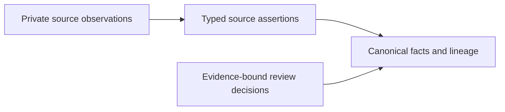
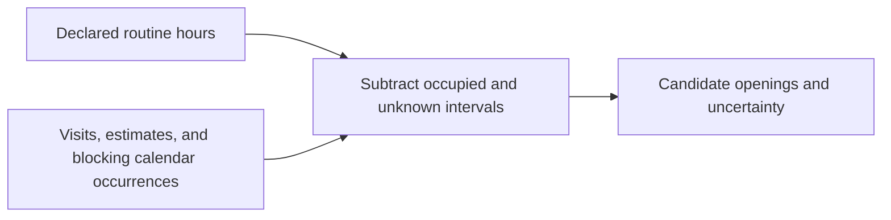

# House Account architecture

House Account turns source observations into evidence-backed service history and candidate schedules. It uses a local SQLite database so imports, review, and queries share one model without a separate database service.

P1 through P4 are implemented and merged. The local system has no live CRM connector, production synchronization worker, or remote authorization layer.

## Source observations and canonical facts

Adapters interpret the six supplied source formats. They preserve original payloads, account-scoped identities, occurrence locations, content hashes, and source times. Normalized source tables retain each source's assertions.

Reconciliation selects canonical identities and facts from those assertions. Deterministic rules can merge supported identities. Ambiguous matches and inferred corrections remain review proposals. Field lineage records the supporting observations, rules, and effective decisions.

The separate source layer makes disagreements inspectable after reconciliation. A selected canonical value does not erase a conflicting observation.

## Jobs, visits, and completed work

A job describes an undertaking. A visit describes one appointment for a job or estimate. Each visit has exactly one parent and derives its provider and property through that parent.

Service completions record evidence that work happened. A completed visit can support history while its recurring job remains active. A completed estimate does not establish performed service. Job-level completion does not fabricate a completed visit.

Jobs and estimates can list several services. A completion receives credit for a particular service only when evidence supports that link. This prevents a completed plumbing visit from proving that every other service listed on the job also happened.

Provider aliases, trades, exclusions, and declared areas use related rows. Observed service areas come from completed work. Property records preserve unresolved links, unknown units, and approximate geocode precision.

The [data model](docs/data-model.md) explains these distinctions. The [column design record](docs/schema-columns-draft.md) records accepted semantics. Executable constraints live in `src/house_account/schema.py` and `src/house_account/storage.py`.

## Persistent identities and publication

An import builds and validates an isolated candidate. Publication updates derived facts and identity state in one transaction on the persistent database. A failed build leaves the prior snapshot available. Readers keep one revision for each read transaction.

The identity registry survives imports. Merges retain redirects from retired IDs. Splits can leave an earlier reference ambiguous rather than silently selecting one descendant.

The review ledger remains authoritative outside the SQLite transaction. Apply records a decision before database publication. If publication then fails, `recorded_not_applied` distinguishes that state from an unrecorded decision. Rebuilding with the same ledger recovers the intended facts.

The [migration guide](docs/p2r-migration.md) covers upgrade and recovery. The [review guide](docs/review-reconciliation.md) covers decisions.

## Candidate availability

Availability is a calculation over declared hours and occupied time. It is not a provider flag stored during import.

Recurrence expands only within the requested horizon. All-day end dates are exclusive. Transparent events do not block time. Opaque tentative holds and out-of-area appointments do.

Missing hours and uncertain intervals reduce what the system can establish. They do not become free time. Capacity remains conservative at provider level, and travel is unmodeled. The [scheduling policy](docs/p3-design.md) defines duration, ranking, and confidence rules.

## Public answers and private evidence

Queries read published facts through consistent read transactions. MCP response models select allowed fields rather than exposing source rows. Controlled service descriptions preserve useful work details without copying private notes.

Neighborhood answers use aggregates or block locations. Exact-home history applies to the supplied home. Homeowner contacts, personal calendar titles, raw notes, review evidence, and internal paths remain private.

Local tool access is trusted. The server does not verify that a caller owns the requested property. Remote authentication and authorization require separate implementation.

## Production boundary

Repeated full-pack imports do not establish production synchronization. Partial deliveries need explicit scope, revision, retry, deletion, and freshness rules. Those contracts appear in [the synchronization requirements](docs/sync-readiness.md).

SQLite remains suitable for the measured local workload. Larger deployments require measurements of record volume, recurrence density, concurrent readers, and refresh cost. Provider count alone does not establish a database limit.
